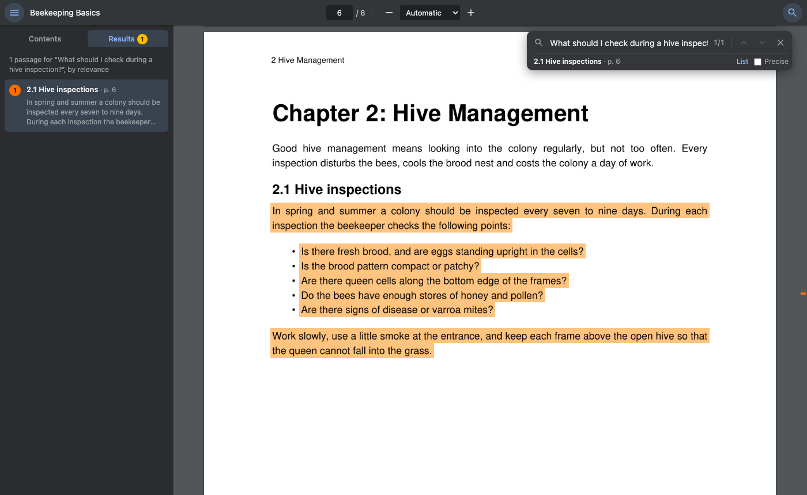

# book-reader

Turn any book PDF into searchable Markdown, then ask it questions and see the answers highlighted on the original pages. Everything runs locally, on a laptop, without an LLM and without sending the book anywhere.



Two parts:

| folder | what it does |
|---|---|
| [`md_encoder/`](md_encoder/README.md) | PDF → structured Markdown: chapters, headings, lists, margin notes, figures, tables, page numbers. Reads the PDF's text layer, or uses OCR (Apple Vision) for scans and screen recordings. |
| [`rag/`](rag/README.md) | Retrieval over that Markdown with LangChain + FAISS + a multilingual embedding model; an evaluation harness that picks the best pipeline; and a PDF-viewer-style reader where ⌘F takes a question and highlights every relevant passage. |

## Quick start

Requirements: [uv](https://docs.astral.sh/uv/), which fetches a suitable Python and the dependencies on first use. Scanned PDFs need macOS; PDFs with a text layer work everywhere.

```bash
# 1. PDF → Markdown (writes mybook/ with chapters, book.json, word boxes for highlighting)
uv run md_encoder/encode.py "My Book.pdf" -o mybook

# 2. Ask from the terminal
uv run rag/rag.py --book mybook ask "What does the author mean by …?"

# 3. Or open the reader: the PDF in the browser, ⌘F for questions
uv run rag/reader.py --book mybook
```

The first `ask` or reader start downloads the embedding model (about 1 GB) and embeds the book, which takes about 40 s for 300 pages. Both are cached, and after that a question takes about 20 ms.

### Try it on the demo book

```bash
uv run examples/make_demo_book.py demo                      # a made-up 8-page book, as digital PDF and as image-only scan
uv run md_encoder/encode.py "demo/Beekeeping Basics.pdf" -o demo/bees
uv run rag/reader.py --book demo/bees
```

For a scored comparison of models on the demo book, copy `examples/questions.example.jsonl` to `demo/bees/rag/questions/` and run `uv run rag/rag.py --book demo/bees eval`.

## How well it works

On a 300-page German textbook (screen-recorded, so every page went through OCR), measured with 94 hand-checked questions:
- The default pipeline puts 81% of all passages a complete answer needs into its result, in about 9 chunks per question.
- 98% of the retrieved text is highlighted exactly on the page.

[rag/README.md](rag/README.md) has the comparison of embedding models, rerankers and chunk sizes.

## Your book stays out of git

`.gitignore` is an allow-list. Only the code folders, `examples/` and `docs/` can be committed. Book PDFs, the generated Markdown, caches and your evaluation questions stay local, so this repository can be shared without the book.
